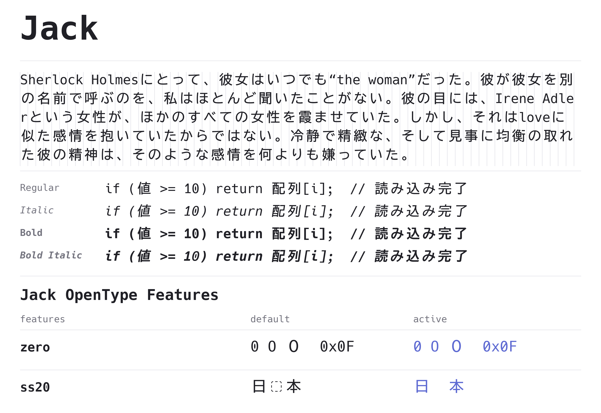
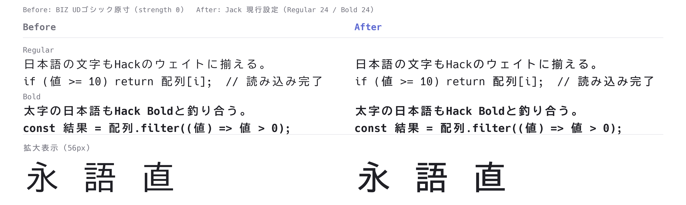
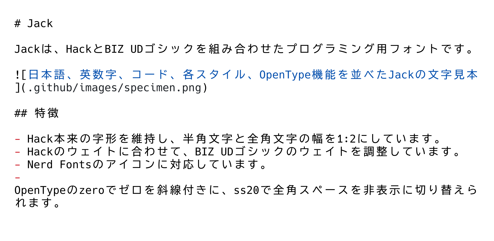
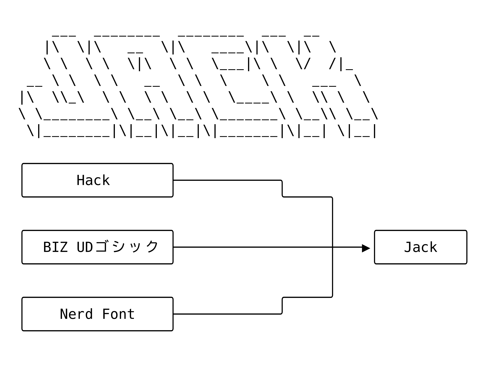

# Jack

Jackは、HackとBIZ UDゴシックを組み合わせたプログラミング用フォントです。



## Features

- Hack本来の字形を維持し、半角文字と全角文字の幅を1:2にしています。
- Hackのウェイトに合わせて、BIZ UDゴシックのウェイトを調整しています。
- Nerd Fontsのアイコンに対応しています。
- OpenTypeのzeroでゼロを斜線付きに、ss20で全角スペースを非表示に切り替えられます。



## Showcase





## Development

- Runtime, system library: Nix
- Python dependencies: uv

### Setup

```sh
direnv allow   # or run; nix develop
uv sync
```

### Build / Testing

```sh
uv run build
uv run pytest
nix fmt
```

### Build configuration

`config.toml`でフォントビルド時のパラメータを設定できます。

### Release publishing

`pyproject.toml`で`project.version`を繰り上げてタグをpushします。 

## ライセンス

SIL Open Font License 1.1.
