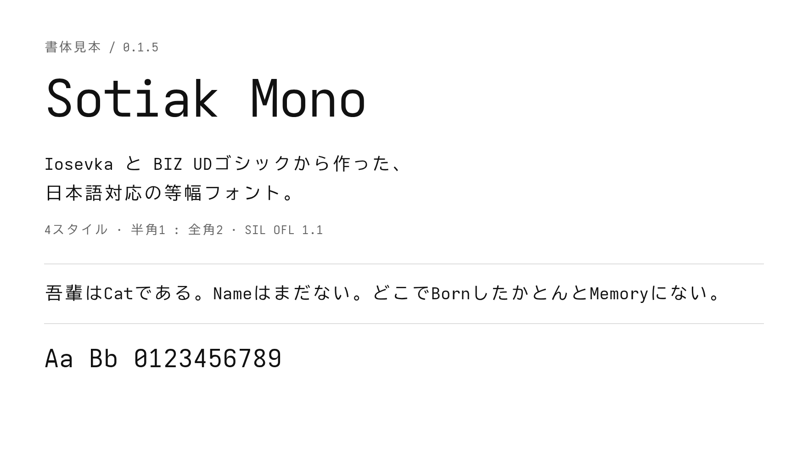

# Sotiak Mono

Sotiak Monoは、IosevkaをベースにBIZ UDゴシックを組み合わせた、Nerd Fonts対応のプログラミング用フォントです。

<picture>
  <source media="(prefers-color-scheme: dark)" srcset=".github/images/specimen-hero-dark.png">
  
</picture>

## Showcase

[書体見本サイト](https://sotiak.github.io/mono/) / [HTMLソース](site/index.html)。Iosevka SS03 / JetBrains Mono / Consolasとの比較、字形の設計、代表文字を掲載しています。

<picture>
  <source media="(prefers-color-scheme: dark)" srcset=".github/images/specimen-design-dark.png">
  
</picture>

<picture>
  <source media="(prefers-color-scheme: dark)" srcset=".github/images/specimen-features-dark.png">
  
</picture>

## Development

- Runtime, system library: Nix
- Python dependencies: uv

### Setup

```sh
direnv allow   # or run; nix develop
uv sync
```

### Build / Test

```sh
uv run build
uv run pytest
fontspector --configuration fontbakery.toml dist/SotiakMono-*.ttf
```

### Build configuration

`config.toml`でフォントビルド時のパラメータを設定できます。

### Release publishing

`pyproject.toml`で`project.version`を繰り上げてタグをpushします。 

## ライセンス

SIL Open Font License 1.1。Iosevka、BIZ UDゴシック、Nerd Fonts、0xProto、JetBrains Monoの帰属表示は[assets/licenses](assets/licenses)にあります。
